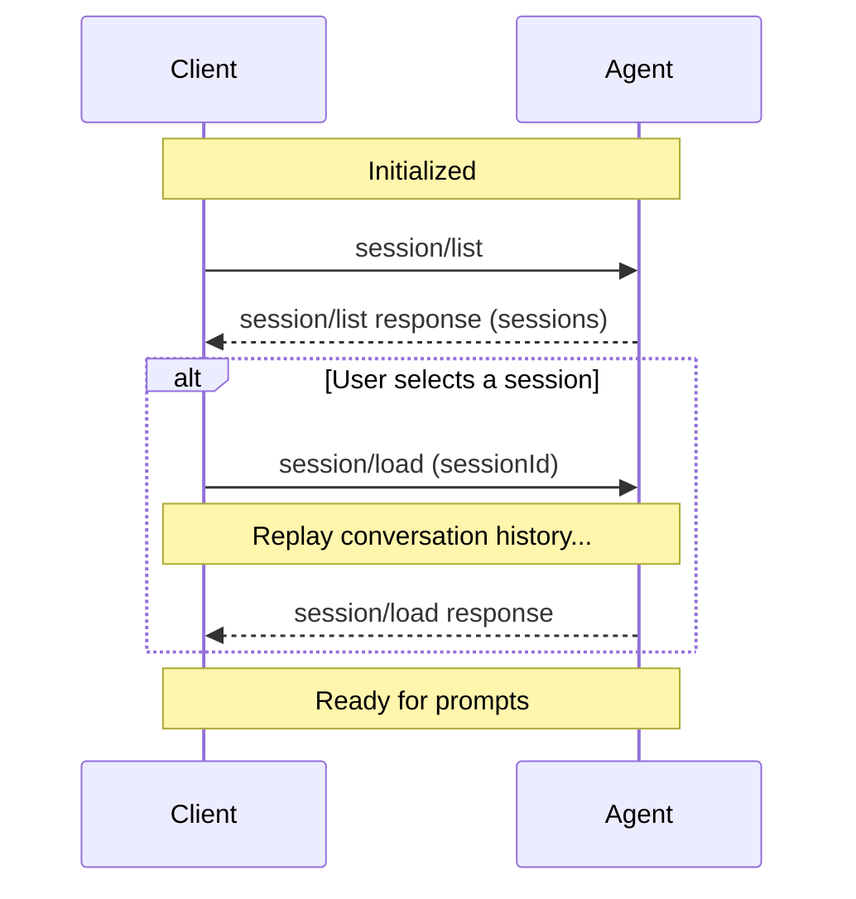

> ## Documentation Index
> Fetch the complete documentation index at: https://agentclientprotocol.com/llms.txt
> Use this file to discover all available pages before exploring further.

# Session List

> Discovering existing sessions

The `session/list` method returns the sessions an Agent knows about. Clients use it to show session history and let users switch between sessions.

Agents can also send a `session_info_update` notification when a session's title or metadata changes, so Clients don't have to poll.

Before listing sessions, Clients **MUST** first complete the [initialization](https://agentclientprotocol.com/protocol/v1/initialization.md) phase to verify the Agent supports this capability.



## Checking support

Before attempting to list sessions, Clients **MUST** verify that the Agent supports this capability by checking the `sessionCapabilities.list` field in the `initialize` response:

```json highlight={7-9} theme={null}
{
  "jsonrpc": "2.0",
  "id": 0,
  "result": {
    "protocolVersion": 1,
    "agentCapabilities": {
      "sessionCapabilities": {
        "list": {}
      }
    }
  }
}
```

If `sessionCapabilities.list` is not present, the Agent does not support listing sessions and Clients **MUST NOT** attempt to call `session/list`.

Agents that also advertise `sessionCapabilities.additionalDirectories` may
include `additionalDirectories` in returned `SessionInfo` objects to report
additional workspace roots for listed sessions.

> [!NOTE]
>
> If the Agent advertises the `sessionCapabilities.delete` capability, Clients
> can remove sessions from future `session/list` results with
> [`session/delete`](https://agentclientprotocol.com/protocol/v1/session-delete).

## Listing sessions

Clients discover existing sessions by calling the `session/list` method with optional filtering and pagination parameters:

```json theme={null}
{
  "jsonrpc": "2.0",
  "id": 2,
  "method": "session/list",
  "params": {
    "cwd": "/home/user/project",
    "cursor": "eyJwYWdlIjogMn0="
  }
}
```

All parameters are optional. A request with an empty `params` object returns the first page of sessions.

**cwd** `string`

Filter sessions by working directory. Must be an absolute path. Only sessions
with a matching `cwd` are returned.

**cursor** `string`

Opaque cursor token from a previous response's `nextCursor` field for
cursor-based pagination. See [Pagination](#pagination).

The Agent **MUST** respond with a list of sessions and optional pagination metadata:

```json theme={null}
{
  "jsonrpc": "2.0",
  "id": 2,
  "result": {
    "sessions": [
      {
        "sessionId": "sess_abc123def456",
        "cwd": "/home/user/project",
        "title": "Implement session list API",
        "updatedAt": "2025-10-29T14:22:15Z",
        "_meta": {
          "messageCount": 12,
          "hasErrors": false
        }
      },
      {
        "sessionId": "sess_xyz789ghi012",
        "cwd": "/home/user/another-project",
        "title": "Debug authentication flow",
        "updatedAt": "2025-10-28T16:45:30Z"
      },
      {
        "sessionId": "sess_uvw345rst678",
        "cwd": "/home/user/project",
        "updatedAt": "2025-10-27T15:30:00Z"
      }
    ],
    "nextCursor": "eyJwYWdlIjogM30="
  }
}
```

**sessions** `SessionInfo[]` *required*

Array of session information objects.

**SessionInfo**

**sessionId** `string` *required*

Unique identifier for the session.

**cwd** `string` *required*

Working directory for the session. Always an absolute path.

**additionalDirectories** `string[]`

If the Agent advertises `sessionCapabilities.additionalDirectories`, it
**MAY** include this field to report the complete ordered additional-root list
associated with the listed session. Omitted and empty values are
equivalent: this `SessionInfo` response reports no additional roots.
Clients **MUST NOT** merge this field with prior values or infer additional
roots from agent-specific state.

**title** `string`

Human-readable title for the session. May be auto-generated from the first prompt.

**updatedAt** `string`

ISO 8601 timestamp of the last activity in the session.

**\_meta** `object`

Agent-specific metadata. See [Extensibility](https://agentclientprotocol.com/protocol/v1/extensibility.md).

**nextCursor** `string`

Opaque cursor token. If present, pass this in the next request's `cursor`
parameter to fetch the next page. If absent, there are no more results.

When no sessions match the criteria, the Agent **MUST** return an empty `sessions` array.

## Pagination

`session/list` uses cursor-based pagination. The request includes an optional `cursor`, and the response includes `nextCursor` when more results are available.

* Clients **MUST** treat a missing `nextCursor` as the end of results
* Clients **MUST** treat cursors as opaque tokens, which means not parsing, modifying, or persisting them
* Agents **SHOULD** return `-32602` if the cursor is invalid
* Agents **SHOULD** enforce reasonable page sizes internally

## Updating session metadata

Agents can update session metadata in real-time by sending a `session_info_update` notification via `session/update`. This follows the same pattern as other session notifications like [`available_commands_update`](https://agentclientprotocol.com/protocol/v1/slash-commands) and [`current_mode_update`](https://agentclientprotocol.com/protocol/v1/session-modes).

```json theme={null}
{
  "jsonrpc": "2.0",
  "method": "session/update",
  "params": {
    "sessionId": "sess_abc123def456",
    "update": {
      "sessionUpdate": "session_info_update",
      "title": "Implement user authentication",
      "_meta": {
        "tags": ["feature", "auth"],
        "priority": "high"
      }
    }
  }
}
```

All fields are optional. Only include fields that have changed. Omitted fields are left unchanged.

**title** `string | null`

Human-readable title for the session. Set to `null` to clear.

**updatedAt** `string | null`

ISO 8601 timestamp of last activity. Set to `null` to clear.

**\_meta** `object`

Agent-specific metadata. See [Extensibility](https://agentclientprotocol.com/protocol/v1/extensibility.md).

The `sessionId`, `cwd`, and `additionalDirectories` fields are **not** included
in the update. `sessionId` is already in the notification's `params`, `cwd` is
immutable after session setup, and ACP does not currently define mid-session
mutation for `additionalDirectories`. Agents typically send this notification
after the first meaningful exchange to auto-generate a title.

## Interaction with other session methods

`session/list` only discovers sessions. It does **not** restore or modify them:

1. Client calls `session/list` to discover available sessions
2. User selects a session from the list
3. Client calls [`session/load`](https://agentclientprotocol.com/protocol/v1/session-setup#loading-sessions) with the chosen `sessionId` to resume the conversation


This documentation is built and hosted on [Mintlify](https://mintlify.com), a developer documentation platform.